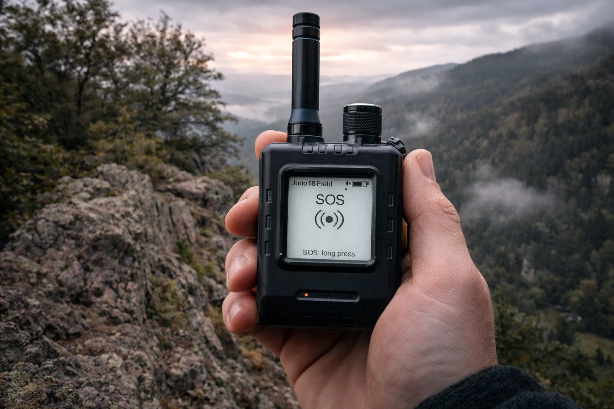
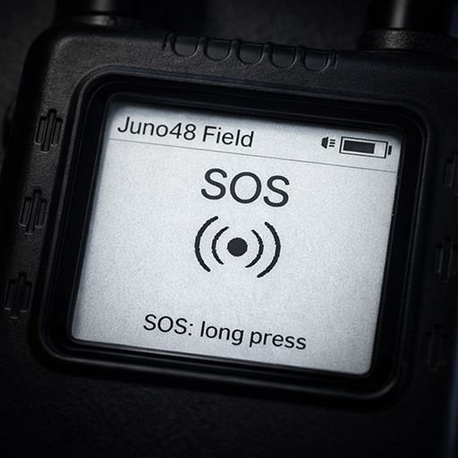
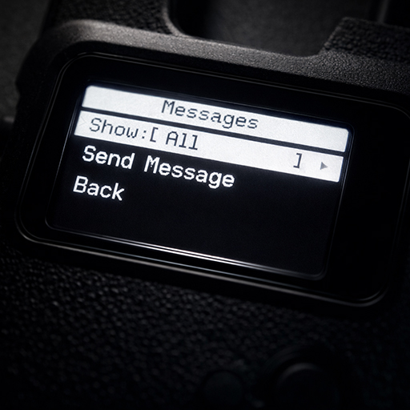
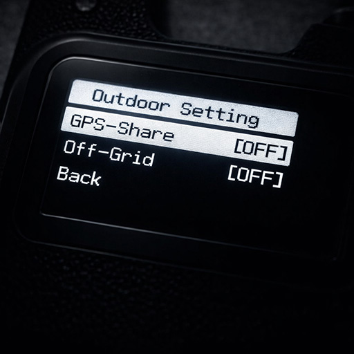
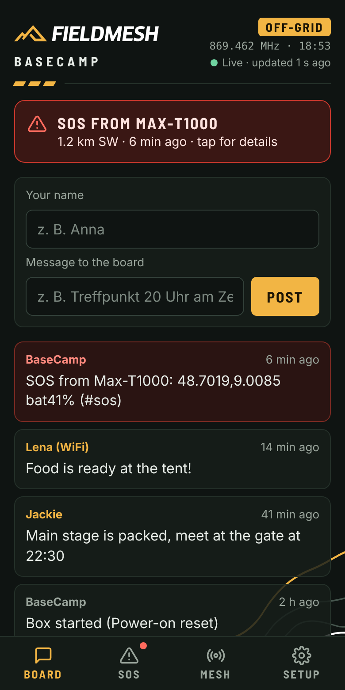
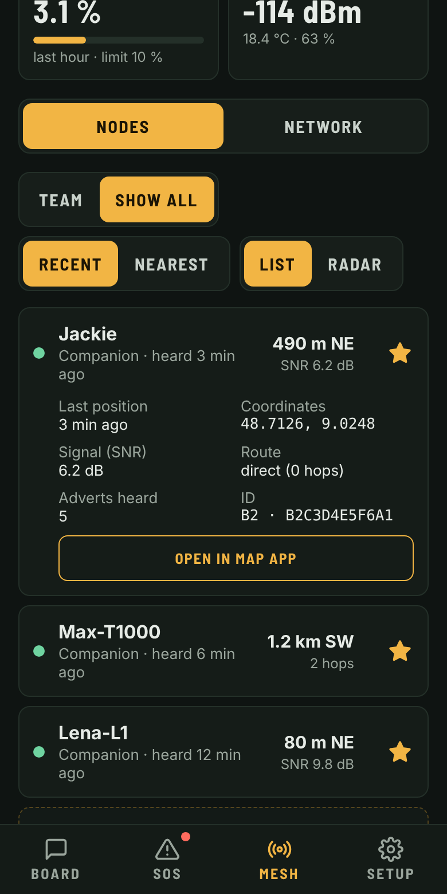
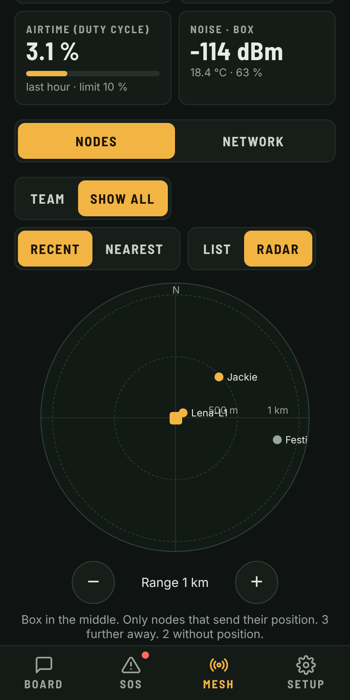
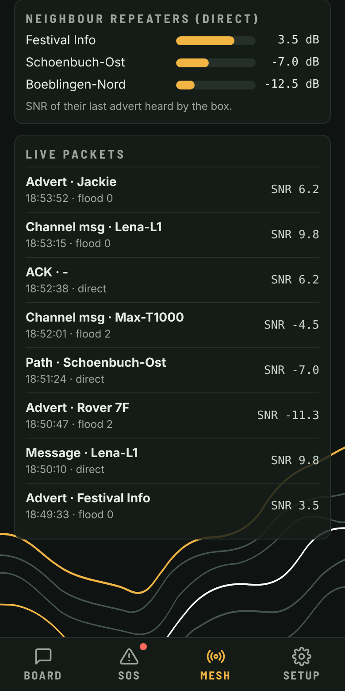

<p align="center">
  <picture>
    <source media="(prefers-color-scheme: dark)" srcset="docs/FieldMesh/brand/logo-dark.svg">
    
  </picture>
</p>

<p align="center"><b>A MeshCore firmware fork optimized for outdoor use — festivals, hiking, off-grid events, and situations where you need your radio network to do more than stock MeshCore offers.</b></p>

<p align="center"></p>

<p align="center">
  <a href="https://fieldmesh-radio.github.io/FieldMesh/"></a>
  <a href="../../releases/latest"></a>
  <a href="https://github.com/meshcore-dev/MeshCore"></a>
</p>

**Contents:** [Why FieldMesh?](#why-fieldmesh) · [Supported devices](#supported-devices) · [Install & update](#install--update) · [Using your device](#using-your-device) · [Features](#features) · [FieldMesh Repeater](#fieldmesh-repeater-station-g2) · [Building](#building-from-source) · [Limitations](#limitations--known-issues) · [FAQ](#faq)

## Why FieldMesh?

MeshCore is a great platform, but some things that matter in the field require manual workarounds or aren't there at all. FieldMesh adds:

- **Battery-friendly GPS tracking** — the GPS sleeps between fixes; your node sends its position when you move, plus a heartbeat every 10 minutes, to nodes in direct range only — no extra network load
- **A tracking page** — your contacts' positions and distances at a glance
- **Off-Grid mode** — one press switches your group to its own frequency (picked automatically for your region) where every node relays
- **SOS** — send and receive emergency alerts with a buzzer alarm, even if your phone isn't connected
- **Messages without a phone** — read received messages on the device; write channel messages on the Wio Tracker L1
- **FieldMesh Repeater** — turns a Station G2 into a base station for your camp: repeater, message board, SOS display, weather and a WiFi dashboard for phones

The goal is a node you can put in your backpack, forget about, and trust that it's doing its job. More about the motivation in my [blog post](https://www.tobiasguertler.de/blog/en/fieldmesh).

## Supported devices

| Device | What it is | Release file |
|---|---|---|
| **Elecrow ThinkNode M1** | Tracker with E-Ink display, GPS switch, one button, buzzer | `ThinkNode_M1_companion_radio_ble_FieldMesh…zip` |
| **Seeed Wio Tracker L1** | Tracker with OLED display and joystick (can write messages) | `WioTrackerL1_companion_radio_ble_FieldMesh…zip` |
| **Seeed T1000-E** | Card-sized tracker without display, one button, buzzer | `t1000e_companion_radio_ble_FieldMesh…zip` |
| **Station G2** | FieldMesh Repeater — base station for a camp or a tour | `Station_G2_fieldmesh_repeater_FieldMesh…_full.bin` |

The trackers are normal MeshCore companions: pair them with the MeshCore app as usual. All FieldMesh features also work without the phone.

Other devices can be [built from source](#building-from-source) but are not tested on hardware and have no prebuilt firmware.

## Install & update

### Web flasher (recommended)

1. Open the **[FieldMesh Web Flasher](https://fieldmesh-radio.github.io/FieldMesh/)** in **Chrome or Edge on a computer** (Windows, macOS, Linux). Phones and Safari do not work.
2. Connect the device with a USB **data** cable and pick it in the list.
3. Follow the two or three steps on the page:
   - **ThinkNode M1, Wio Tracker L1, T1000-E:** *Start update mode*, then *Flash* (pick the port again — its name may change).
   - **Station G2:** *Flash*. If the G2 is not found: hold the download button, press reset briefly, release, click *Flash* again.

The flasher installs the current release, for the first installation and for every update. It never erases the device.

> [!IMPORTANT]
> **Back up your private key first** if you come from a **stock MeshCore repeater** on the Station G2 or from **FieldMesh 1.x** (formerly V5.x). In both cases the device's identity (public key) and settings can be lost:
> - **Station G2:** the FieldMesh Repeater uses a larger app partition. Run `get prv.key` on the USB serial console and keep the output; restore with `set prv.key …`.
> - **Trackers on FieldMesh 1.x:** export the private key in the MeshCore app.
>
> Updates within FieldMesh 2.x keep settings, contacts and identity. Before any first install, exporting the private key in the MeshCore app is a good habit anyway. Since 2.1 the trackers also keep their own backup of identity and settings (see [Identity backup](#identity-backup)).

### Manual install

Download the file for your device from the [latest release](../../releases/latest) (see [Supported devices](#supported-devices)).

- **ThinkNode M1, Wio Tracker L1, T1000-E:** flash the `.zip` with the [MeshCore Flasher](https://flasher.meshcore.io) as custom firmware.
- **Station G2:** write the `…_full.bin` at address **0x0** with [esptool-js](https://espressif.github.io/esptool-js/). Do **not** use *Erase Flash*. Download mode: hold the download button, press reset briefly, release.

### Updating the repeater

- **From the dashboard** (once the box is running): *Setup* → log in → *Firmware update*, upload the `…_update.bin`. Settings, room, team and identity stay. The box restarts by itself.
- **Via USB:** the FieldMesh Web Flasher or esptool-js (full image at 0x0, as above). This always works.

<details>
<summary><strong>Why not the update file or the MeshCore Flasher over USB?</strong></summary>

The ESP32 has two app slots. An update from the dashboard is written to the slot that is not running and the box then starts from there. Flashers that write the update file to 0x10000 (like the MeshCore Flasher) always write slot 1 — if the box currently runs from slot 2, that update is ignored. The full image also resets the start slot to slot 1.

</details>

## Using your device

<p align="center">
  
  
  
</p>

More pictures: [UI images](docs/FieldMesh/images/)

### ThinkNode M1 and Wio Tracker L1 (display)

**Pages** (left to right): Messages · Recent · Tracking · Radio · GPS · Sensors (where available) · Repeater discovery · SOS

| | ThinkNode M1 (one button) | Wio Tracker L1 (joystick) |
|---|---|---|
| Next / previous page | Short press / double press | Joystick right / left |
| Page action | Long press | Long joystick press (short press on Messages, GPS and Repeater discovery) |
| Buzzer on/off | Triple press | Triple press on the back button |
| Back | — | Back button |

| Page | Page action |
|---|---|
| Messages | Message menu: all messages, favourites only, *Send Message* (L1) |
| Recent | Send an advert now |
| Tracking | *Outdoor Settings*: **GPS-Share** (tracking) and **Off-Grid** on/off |
| GPS | GPS on/off |
| Repeater discovery | Scan for repeaters in direct range |
| SOS | Open the SOS send screen (two steps) |

In the message history a short press shows the next message, a long press clears all. On an SOS alarm, a long press acknowledges it. A long press within the first 8 seconds after power-on starts the CLI rescue mode (upstream).

**ThinkNode M1 GPS switch:** the GPS only runs when the hardware switch **and** the GPS setting are on. Turning the switch on also turns the setting on.

### T1000-E (no display)

| Button | Action |
|---|---|
| 1× | Acknowledge an SOS alarm |
| 1× + hold 5 s | Send SOS (v2.2, see below) |
| 2× | Send an advert now |
| 3× | Buzzer on/off |
| 4× | GPS and tracking (GPS-Share) on/off together (v2.2, saved, survives a restart) |
| 5× | Off-Grid on/off (saved, survives a restart) |
| Long press | Power off (within the first 8 s after power-on: CLI rescue mode) |

**Sending SOS (v2.2):** press once, then press again within half a second and **hold**. The buzzer beeps faster and faster and the LED blinks along. After 5 seconds the SOS is sent (one long tone). Release earlier to cancel (short descending tone) — nothing is sent. Three short low tones mean no SOS channel was found. A normal long press without a click before still powers off.

**4×** switches GPS and tracking together: if both are on, both go off; otherwise both go on. GPS without tracking can still be set in the MeshCore app.

Every action answers with a tone, even when the buzzer is muted:

| Tone | Meaning |
|---|---|
| Ascending (c → e) | Turned on (GPS + tracking, buzzer, Off-Grid) |
| Descending (e → c) | Turned off / SOS countdown cancelled |
| Double beep | Advert sent |
| Faster and faster beeps | SOS countdown (click + hold) |
| Long tone | SOS sent |
| Three short low tones | SOS not sent — no SOS channel |
| Continuous siren | SOS alarm received — press once to acknowledge |

**Status LED (v2.2):**

| LED | Meaning |
|---|---|
| On for 2 s | Starting |
| Short flash every 4 s | Normal |
| Soft pulse every 4 s | Tracking on (GPS + GPS-Share) |
| Blinking faster and faster | SOS countdown |
| Fast blinking | SOS alarm received |

Off-Grid, charging and low battery are not shown on the LED.

To check the Off-Grid state: press 5× and listen (ascending = was off, now on; descending = was on, now off), then press 5× again to return to the original state.

## Features

### GPS Tracking & Auto-Advert

FieldMesh separates two things that stock MeshCore conflates: *when did I last hear from this node* and *when did this node last have a GPS fix*. The **RECENT** page shows all recently heard nodes. The **TRACKING** page shows only nodes that have sent a GPS position, with the distance to you — green (< 5 min) or yellow (older). Only contacts marked as favourites in the MeshCore app appear on the Tracking page (max. 3).

**GPS duty cycle.** While GPS is on, the receiver takes a fix every 2 minutes and sleeps in between — the same approach Meshtastic uses. The search time adapts to the sky the receiver can see (short indoors, longer under open sky), and all satellite systems the chip supports (GPS, GLONASS, Galileo, BeiDou) are used. On the T1000-E this gave about 2–2½ days with GPS on in our tests (no exact current measurement). Devices whose GPS cannot be switched off keep it running.

**Tracking (GPS-Share on).** Your node sends its position when it matters instead of on a fixed timer:

| When | What is sent |
|---|---|
| First fix after GPS-Share or GPS is switched on | Advert with position |
| You moved ≥ 100 m since the last sent position | Advert with position, at most every 2 min |
| Moving fast (≥ 30 km/h, e.g. by car or bike) | Fix every 60 s, adverts at most every 60 s |
| Nothing changed for 10 min | Heartbeat advert (with position if the last fix is ≤ 2 min old) |

In normal mode adverts are sent **zero-hop** — they only reach nodes in direct range and add no load to the wider network. In Off-Grid mode they are flooded, so the whole group sees them. A position is only included when the fix is at most 2 minutes old — never stale or cached coordinates.

### Off-Grid Mode

One press switches your node to a **separate Off-Grid frequency** and turns on **Client Repeat**, so every FieldMesh node in your group relays for the others — useful in the mountains, at a festival or anywhere without mesh infrastructure. Your normal radio settings are saved and restored when you switch back. Switching sends an advert right away so nearby nodes know.

The region is picked automatically from your normal frequency — one firmware for all regions:

| Your normal frequency | Off-Grid uses |
|---|---|
| below 900 MHz (EU/UK) | **869.4625 MHz** / BW125 / SF11 / CR5 (EU sub-band g3: 500 mW ERP, 10 % duty cycle) |
| 900 MHz and above (US/AU) | **916.4625 MHz** / BW125 / SF11 / CR5 |

Off-Grid does not overlap with your normal MeshCore network: the EU/UK Narrow preset, for example, runs on 869.618 MHz / BW62.5 — there is a ~62 kHz gap. In Off-Grid you only see nodes that are also in Off-Grid.

FieldMesh also corrects the Client Repeat frequency ranges of upstream MeshCore to legal values:

| Region | Range |
|---|---|
| EU 433 MHz | 433.050 – 434.790 MHz |
| EU 869 MHz | 869.400 – 869.650 MHz (sub-band g3) |
| US/AU 915 MHz | 915.000 – 928.000 MHz |

> [!WARNING]
> Off-Grid has no frequency for other regions (e.g. India, Japan, Korea). Do not use Off-Grid there.

#### Smarter relaying in Off-Grid (v2.2)

In Off-Grid every FieldMesh device relays. With many devices close together (festival, camp, ski area) that used to mean every packet was sent again by everyone at once — packets collided and the channel filled up. Since v2.2 FieldMesh uses the **managed flooding of Meshtastic**, a method proven in the field. Our simulations: 20 devices get about the delivery that 10 devices had before (adverts and messages ~92 % instead of ~65 %), with half the airtime.

- **Wait for a free channel:** a device waits up to 30 s for a free channel instead of sending over others after 4 s.
- **Far devices relay first:** the relay delay depends on how well the packet was heard. A device that hears the sender weakly (probably further away) relays early, devices close to the sender wait longer.
- **No duplicate adverts:** if a device hears that another one already relayed an advert, it drops its own relay. **Messages and SOS are always relayed**, exactly as before.
- **FieldMesh Repeater (Station G2) relays last:** it always relays, but if another device relayed first, it waits until the companions had their turn (Meshtastic `ROUTER_LATE`). A badly placed box (in the car, in the valley) fills gaps instead of talking over the group.
- Switching Off-Grid on or off drops all relays still waiting, so nothing heard in one network is sent into the other.
- **The repeater relays everything in Off-Grid:** region / scope rules and the hop limits for un-scoped packets and adverts (`flood.max.unscoped`, `flood.max.advert`) only apply in normal operation, and its own packets go out without scope, like those of the companions. Still applied in Off-Grid: `set repeat off`, the general `flood.max` limit and loop detection.

What you notice:

- Messages take a few seconds longer per hop (about 1–22 s at SF11 instead of 0–4 s). Direct messages get 44 s more time for the delivery confirmation, so they are not shown as failed while the reply is on its way. If the repeater is the only link between two groups, it can take ~15 s longer.
- In thin networks without a repeater (one device as the only link between two groups) a few more adverts (positions) can get lost; messages arrive more reliably than before. A FieldMesh Repeater at that spot fixes it.
- If you set an interference threshold (`int.thresh`) and there is constant noise, a device in Off-Grid sends only after 30 s instead of 4 s.
- Counters (Off-Grid only): RADIO page of the ThinkNode M1 shows `Flood TX` and `Relay skip` (adverts not relayed because another device did), the Wio Tracker L1 shows `Skip` next to the TX power. Repeater: dashboard → Network → *Relays sent late*, CLI `get offgrid`.

Normal operation (Off-Grid off) is unchanged. Devices with v2.1 or stock MeshCore in the same Off-Grid network keep working; they relay as before.

### SOS

On the SOS page, a long press opens a two-step confirmation screen (protection against accidental triggering). On the T1000-E: click once, then press again and hold for 5 seconds (v2.2, see [T1000-E](#t1000-e-no-display)). FieldMesh sends to the channel whose name contains "sos" (case-insensitive, e.g. `#sos`) — set one up in the MeshCore app first. The message carries your position and battery level:

```
!SOS 48.7636,9.1621 bat78%
!SOS no GPS bat78%
```

The position is used if the last fix is at most 2 minutes old. Sending an SOS switches the GPS on if it was off, and it stays on afterwards (v2.2). For 10 minutes after sending, the GPS runs without pause; if the first SOS went out without a position, it is sent once more as soon as a fix is available. ThinkNode M1: if the hardware GPS switch is off, the display shows "GPS switch is off!" — turn it on within the 10 minutes and the SOS is still resent with position. Switching Off-Grid on or off (or changing the radio settings) drops a pending resend, so it never goes out into a network that did not get the first SOS.

**Receiving:** an `!SOS` message **in an SOS channel** triggers a buzzer alarm that overrides quiet mode and loops until you acknowledge it. The alert screen shows the sender's name (the T1000-E LED blinks fast); normal messages are held back while the alarm is active. `!SOS` in any other channel (e.g. Public) is shown as a normal message — no alarm.

### Messages without a phone

**Message history (all devices with a display).** Received messages are kept in RAM (up to 32) and can be read on the device. The home screen shows an unread counter and the latest message from a favourite. The message menu filters for all messages or favourites only. The history shows one message at a time, newest first, with sender, channel or `[DM]`, time and text. When you have stepped through all unread messages, the display returns to the home screen.

What you read or clear on the device never affects the MeshCore app — the app still gets all messages.

**Writing messages (Wio Tracker L1).** Message menu → *Send Message*:

1. Choose a channel with the joystick.
2. Pick the characters one by one (left/right, short press confirms); a long press sends.
3. "Sent!" is shown, then the message history.

Up to 20 characters, channels only (no direct messages).

### Identity backup

Since 2.1 FieldMesh keeps a copy of the node identity (`/_main.id`) and settings (`/prefs.json`) in a second file system: the external QSPI flash on the ThinkNode M1 and Wio Tracker L1, a separate area of the internal flash on the T1000-E. If the main copy is lost (for example after an update), it is restored automatically at the next start.

A factory reset from the app or CLI also clears the backup — that is how you really start over. BLE pairings are not part of the backup.

## FieldMesh Repeater (Station G2)

<p align="center">
  
  
  
  
</p>

The FieldMesh Repeater turns a **Station G2** into a base station for a camp, a festival or a multi-day tour — for example in a box with a power station. It is a normal MeshCore repeater (all repeater settings and CLI commands work as usual) with these additions:

- **Off-Grid** — switch the whole repeater to the Off-Grid frequency of your FieldMesh nodes and back, from the menu, the CLI or the dashboard
- **Message board** — a room server as a **second identity** next to the repeater (own name and key, e.g. "BaseCamp"); the repeater keeps repeating
- **Room commands** — `!weather`, `!ping`, `!status` for everyone, `!commands` and `/<CLI command>` for the repeater admin, right from the room chat
- **SOS on the board** — SOS messages heard in your SOS channels appear on the board and in the dashboard
- **WiFi dashboard** — an open WiFi for phones with board, SOS, nodes (list and radar), network statistics and setup
- **Weather** — phones in the WiFi that have mobile data load a 48 h forecast for the box; `!weather` (or `!wetter` in German) answers in the room even when nobody has internet out in the field

FieldMesh never changes the transmit power — keep the manufacturer's recommended setting for the Station G2.

### Getting started

1. **Install** the FieldMesh Repeater — see [Install & update](#install--update). Coming from a stock MeshCore repeater: back up the key first.
2. **Set the repeater up as usual** (name, admin password, radio preset, location) with the MeshCore app or the CLI. Set the box position with `set lat` / `set lon` or later in the dashboard — it is needed for distances, the radar and the weather.
3. **Turn on the board:** `set roomserver BaseCamp` (or *Room* in the G2 menu). Optional password: `set room.pass <pw>`.
4. **Turn on the WiFi dashboard:** `set wifi on` (or *WiFi* in the G2 menu). The WiFi is named after the room (or after the repeater while the room is off).
5. **Stick a QR code on the box** pointing to `http://192.168.4.1`. Phones join the WiFi, open the address and are moved on to `http://<room name>.local` where supported (e.g. "BaseCamp" → `http://basecamp.local`).
6. **Optional:** log in under *Setup* with the repeater admin password, add your SOS channel (e.g. `#sos`) and star your team members in *Mesh*.

### Menu on the G2

Short press = next page, long press = action. The display always wakes up on the status page.

| Page | Long press |
|---|---|
| Status | — (mode, frequency, SF, BW, CR) |
| Off-Grid | Off-Grid on/off (EU/US picked automatically) |
| Room | Board on/off (shows clients and posts) |
| Room reset | Deletes posts, users and password; the name stays. Long press twice within 5 s |
| WiFi | Dashboard WiFi on/off (shows the WiFi name, `192.168.4.1` and connected phones) |
| Power | Turn off |

### The board (room server)

The room is a second identity with its own key and name, so the apps show it as a normal room server next to the repeater. Without a password everyone can read and write; with a password everyone who knows it. Changing the password logs everybody out. The board keeps the last 32 posts; posts and logged-in users survive a restart.

The box posts on its own: a short note when it starts ("Box started (…)") and every SOS heard in an SOS channel. Posts from the dashboard appear as "Name (WiFi)".

**Commands in the room chat:**

| Command | Who | Answer |
|---|---|---|
| `!help` | everyone | The user commands (one message, only to you) |
| `!weather` / `!wetter` | everyone | Weather for the box location, **to everyone** on the board — in English (`!weather`) or German (`!wetter`) |
| `!ping` | everyone | Signal check: SNR, RSSI and hops (only to you) |
| `!status` | everyone | Uptime, mode, frequency, users, posts, box temperature (only to you) |
| `!commands [topic]` | repeater admin | CLI commands by topic: `room`, `radio`, `wifi`, `sos`, `team`, `weather` |
| `/<CLI command>` | repeater admin | Runs any repeater CLI command remotely, e.g. `/get radio`, `/set offgrid on` |

"Repeater admin" means: your device is logged in to the **repeater** as admin. The room itself has no admin login. Commands are not posted on the board.

### WiFi dashboard

The dashboard is an open WiFi on the box (up to 10 phones) and a web page that works without internet. It updates live without reloading — open rows, zoom levels and half-typed text stay where they are. Light, dark or automatic theme (per phone).

| Tab | What you see |
|---|---|
| **Board** | Posts with time; write to the board from the phone; SOS banner |
| **SOS** | SOS messages heard by the box with position, distance and direction from the box, battery, "Open in map app" |
| **Mesh → Nodes** | Your team first ("Show all" for everyone), sorted by last heard or distance; list or radar (250 m – 10 km); team members not heard for 30 min are dimmed. "Last heard" counts adverts and also logins, posts and keep-alives to the room or the repeater |
| **Mesh → Network** | Box status, activity of the last hour, airtime, packet types, neighbour repeaters, hash collisions, live packets |
| **Setup** | Theme; after login with the repeater admin password: Off-Grid, room (name, password, clean up), SOS channels, box position, weather, firmware update, WiFi off |

There is **no captive portal**: the WiFi tells phones that it has no internet (like a printer), so phones keep using mobile data for everything else and people who only see the WiFi name are not led to the dashboard. Phones that open the page set the box clock (the G2 has no battery-backed clock; it only ever moves forward).

**Box position:** in *Setup* paste coordinates or a map link — e.g. from Apple Maps (blue dot → share or copy the coordinates) or Google Maps. Decimal degrees with point or comma, degrees/minutes/seconds and N/S/E/W (or German O for east) are understood; short links (`maps.app.goo.gl`) are not.

**Team:** stars (favourites) are set by the admin after logging in. Team members and their last known data (name, position, last heard) survive a restart; other heard nodes are kept in RAM only.

### Weather

The box has no internet. Every phone that opens the dashboard and has mobile data loads the forecast for the box location from [Open-Meteo](https://open-meteo.com) in the background when the data on the box is older than 3 hours — nobody has to do anything (or tap *Load now* in *Setup*). The box stores the next 48 hours and builds the answer from them at the moment someone asks, so one download is enough for about two days. `!weather` answers in English (°C and km/h, or °F and mph for US users — *Setup → Weather* or `set weather.units imperial`), `!wetter` in German:

```
Weather: 16°C, mostly sunny. Rain from 17:00 (80 %). Night 8°C, tomorrow 8–16°C.
Weather: 12°C, rain. Dry from about 19:00. Gusts up to 55 km/h from 15:00. Night 7°C, tomorrow 7–12°C.
Wetter: 16°, meist sonnig. Regen ab 17 Uhr (80 %). Nacht 8°, morgen 8–16°.
```

The answer gives the weather now, the most important event of the next 12 hours (thunderstorm, rain or snow, "possible" from 30 %, otherwise how long it stays dry), gusts above 50 km/h, the night low and tomorrow's range, and the age of the data when it is older than 6 hours. The weather location is the box position, or other coordinates set in *Setup* or with `set weather.loc`.

### What survives a restart

| Kept | Lost (RAM only) |
|---|---|
| Repeater settings, Off-Grid state, room (name, password, posts, users), WiFi on/off, SOS channels, team with last known data, weather forecast, clock (as a high-water mark, saved every 5 min) | Other heard nodes, SOS list in the dashboard (the SOS posts on the board stay), statistics |

### CLI reference

All MeshCore repeater commands work as usual. FieldMesh adds:

<details>
<summary><strong>FieldMesh repeater commands</strong></summary>

| Command | What it does |
|---|---|
| `set offgrid on` / `off` · `get offgrid` | Off-Grid on/off (frequency from the normal frequency: EU 869.4625 / US 916.4625 MHz); normal settings are restored. `get offgrid` also shows the relays sent late (v2.2) |
| `set roomserver <name>` | Board on with this name |
| `set roomserver on` / `off` · `get roomserver` | Board on (last name, else the repeater name) / off |
| `set room.pass <pw>` · `get room.pass` | Room password; `set room.pass` without a password = open. Logs everybody out |
| `room.reset` | Deletes posts, users and password; name and key stay (same as the menu) |
| `room.clear posts` / `users` / `pass` / `name` | Deletes only that part (`name`: back to the repeater name) |
| `room.delete` | Deletes everything incl. name and key and turns the room off; the next `on` starts a new room |
| `channel.add #name` | Listens to a hashtag channel |
| `channel.add <name> <32 hex key>` | Listens to a private channel |
| `channel.del <name>` · `get channels` · `get sos` | Remove a channel / list channels / last SOS heard |
| `team.add <name>` · `team.del <name>` · `get team` | Team members (stars in the dashboard) |
| `team.key <12 hex> on` / `off` · `get nodes` | Team by key prefix / nodes heard |
| `set wifi on` / `off` · `get wifi` | WiFi dashboard on/off (saved) |
| `set weather.loc <lat>,<lon>` / `box` · `get weather` | Weather location: other coordinates / box position; status of the data |
| `set weather.units metric` / `imperial` | `!weather` in °C and km/h (default) or °F and mph; `!wetter` is always metric |
| `start ota` | With the dashboard on: points to *Setup → Firmware update*; otherwise the upstream OTA |

A channel whose name contains "sos" is an SOS channel: `!SOS` messages there go to the board and the SOS tab. Up to 8 channels.

</details>

## Building from source

FieldMesh builds the same way as MeshCore, with [PlatformIO](https://platformio.org). No additional dependencies beyond what MeshCore already requires.

| Device | Environment |
|---|---|
| ThinkNode M1 | `ThinkNode_M1_companion_radio_ble` |
| Wio Tracker L1 | `WioTrackerL1_companion_radio_ble` |
| T1000-E | `t1000e_companion_radio_ble` |
| Station G2 (FieldMesh Repeater) | `Station_G2_fieldmesh_repeater` |
| Station G3 ESP32 (FieldMesh Repeater, untested) | `Station_G3_ESP32_fieldmesh_repeater` |
| Heltec V4 OLED (FieldMesh Repeater, untested) | `heltec_v4_fieldmesh_repeater` |

`…_companion_radio_usb` environments connect to the app over USB instead of BLE.

```
pio run -e ThinkNode_M1_companion_radio_ble
pio run -e Station_G2_fieldmesh_repeater                 # firmware.bin = update file
pio run -e Station_G2_fieldmesh_repeater -t mergebin     # firmware-merged.bin = full image (0x0)
```

Your own builds show the FieldMesh version **dev**. To put a version on them, set it as a build flag (the release workflow does the same):

```
PLATFORMIO_BUILD_FLAGS="-DFIELDMESH_VERSION='\"v2.2.0-mybuild\"'" pio run -e ThinkNode_M1_companion_radio_ble
```

**Which version is on my device?** The splash screen shows it (M1, L1, Station G2). In the app the firmware version reads like `v1.18.0-fm2.2.0` (MeshCore 1.18.0, FieldMesh 2.2.0) – also on the T1000-E; on the repeater also via `ver` and on the dashboard (Network).

**Untested devices** (build from source only, no prebuilt firmware): Heltec Mesh Node T1, SenseCAP MeshTracker X1, Wio Tracker L1 E-Ink, Wio Tracker L1 1W, and as FieldMesh Repeater the Heltec V4 and the Station G3 ESP32. Other single-button devices without a display (e.g. RAK WisMesh Tag) could work like the T1000-E — contributions welcome.

The code is written to be portable: hardware-specific pins are in `variant.h`, the layout uses runtime display size checks, and joystick-specific UI behaviour is guarded by `#if UI_HAS_JOYSTICK`. If you test FieldMesh on another device, please share your findings in [Discussions → Hardware](../../discussions/categories/hardware).

## Limitations & Known Issues

- Tested on ThinkNode M1, Wio Tracker L1, T1000-E and Station G2 only
- Off-Grid knows EU/UK and US/AU frequencies only — do not use it in other regions (e.g. India, Japan, Korea)
- SOS needs a channel whose name contains "sos" — for sending and for the alarm
- The Tracking page shows at most 3 contacts (favourites in the MeshCore app)
- The message history is RAM-only — it is empty after a restart (on purpose)
- Writing messages on the device: Wio Tracker L1 only, channels only (no direct messages)
- Repeater: switching from a stock repeater changes the partition table — back up the key first (see [Install & update](#install--update))
- Repeater: the dashboard WiFi is open (no password) — anyone in range can read the board and see node positions; setup actions need the admin password
- Repeater: weather only arrives when a phone with mobile data opens the dashboard; some Android phones keep all traffic on the box WiFi and cannot load it

## FAQ

### Installing and updating

<details>
<summary><strong>Which file do I need?</strong></summary>

None, if you use the [FieldMesh Web Flasher](https://fieldmesh-radio.github.io/FieldMesh/) — it picks the right file. For a manual install: `.zip` for ThinkNode M1, Wio Tracker L1 and T1000-E, `…_full.bin` for the Station G2. The `…_update.bin` is only for updating a running FieldMesh Repeater from its dashboard. See [Supported devices](#supported-devices).

</details>

<details>
<summary><strong>Will I lose my contacts, settings or identity when updating?</strong></summary>

Not when you update FieldMesh 2.x — neither the web flasher nor the dashboard update erases anything. Back up your private key first if you come from a stock MeshCore repeater on the Station G2 or from FieldMesh 1.x (formerly V5.x); in those cases identity and settings can be lost. See [Install & update](#install--update).

</details>

<details>
<summary><strong>Can I flash from my phone?</strong></summary>

No. Flashing over USB needs Chrome or Edge on a computer (Windows, macOS, Linux). A running FieldMesh Repeater can be updated from a phone through its dashboard.

</details>

<details>
<summary><strong>The web flasher does not find my device or "Start update mode" does nothing</strong></summary>

Use a USB data cable (some cables only charge) and close other programs that use the port (e.g. a serial monitor or the MeshCore app over USB). If *Start update mode* does nothing, put the device into update (DFU) mode by hand — see the device's manual — then click *Flash*. Station G2: hold the download button, press reset briefly, release, then click *Flash* again.

</details>

<details>
<summary><strong>Repeater: an update over USB has no effect</strong></summary>

The box probably runs from its second app slot after an update from the dashboard, and the update file was written to the first one (this happens with the MeshCore Flasher). Use the FieldMesh Web Flasher, update from the dashboard again, or flash the full image at 0x0 with esptool-js. See [Updating the repeater](#updating-the-repeater).

</details>

### Tracking & GPS

<details>
<summary><strong>Why do I not see some nodes on the Tracking page?</strong></summary>

The Tracking page only shows nodes that

- have sent a GPS position (GPS on, with a fix, and GPS-Share on), and
- are marked as favourites in the MeshCore app.

It shows at most 3 nodes, so the display stays readable in the field; newer adverts can replace older entries. A node that is on the Recent page but not on Tracking has most likely sent no position or is not a favourite.

</details>

<details>
<summary><strong>Why is my own position not shown or sent?</strong></summary>

Your device needs a GPS fix. Check that GPS is on (long press on the GPS page, 4× press on the T1000-E — switches tracking on too — and the hardware switch on the ThinkNode M1) and that the GPS page does not show "NO FIX". For tracking, GPS-Share must be on too (Tracking page → *Outdoor Settings*, or location sharing in the MeshCore app).

</details>

<details>
<summary><strong>How often is my position sent?</strong></summary>

With GPS-Share on: at the first fix, whenever you moved 100 m or more (at most every 2 minutes, every 60 s when moving fast), and otherwise every 10 minutes as a heartbeat. See [GPS Tracking & Auto-Advert](#gps-tracking--auto-advert).

</details>

<details>
<summary><strong>Why are my positions not forwarded through the mesh?</strong></summary>

In normal mode, position adverts are sent zero-hop (direct range only) to keep load off the wider network. In Off-Grid mode they are flooded through your group.

</details>

<details>
<summary><strong>Why does my GPS show no fix for a moment?</strong></summary>

The GPS sleeps between fixes to save battery and wakes up shortly before the next one (every 2 minutes). Indoors it only searches briefly; under open sky it searches longer. Open the GPS or Tracking page to keep it awake while the display is on.

</details>

<details>
<summary><strong>Why is the distance to other nodes inaccurate?</strong></summary>

It is a rough estimate: it is calculated once when a position is received and not updated continuously, to save energy. GPS accuracy also depends on the surroundings.

</details>

### Off-Grid

<details>
<summary><strong>What is Off-Grid mode and when should I use it?</strong></summary>

Off-Grid switches your node to a separate frequency and turns on Client Repeat, so every FieldMesh node in your group relays for the others. Use it where there is no mesh infrastructure (mountains, remote areas), for a closed group, or to keep a busy group off the main network. Your normal radio settings are saved and restored when you switch back. See [Off-Grid Mode](#off-grid-mode).

</details>

<details>
<summary><strong>Why do I see fewer nodes — or none from the wider network?</strong></summary>

Off-Grid is probably on. In Off-Grid you only see nodes that are also in Off-Grid; messages from the main mesh do not reach you. Switch Off-Grid off to get back to the normal network.

</details>

<details>
<summary><strong>Can I change the Off-Grid frequency?</strong></summary>

It is picked automatically from your normal frequency: below 900 MHz the EU frequency (869.4625 MHz), from 900 MHz the US frequency (916.4625 MHz). Other frequencies can only be set in the code (`OffGrid.h`). Do not use Off-Grid in other regions.

</details>

### SOS

<details>
<summary><strong>How do I send an SOS?</strong></summary>

First create a channel whose name contains "sos" (e.g. `#sos`) in the MeshCore app — on your device and on your group's devices. Then: SOS page → long press → confirm in two steps. On the T1000-E: click once, then press again and hold for 5 seconds. The message `!SOS` goes to that channel with your position (if the last fix is at most 2 minutes old, otherwise "no GPS") and your battery level. The GPS is switched on if it was off and stays on; for 10 minutes it runs without pause and sends the position once more if the first SOS had none — unless you switch Off-Grid or change the radio settings in the meantime.

</details>

<details>
<summary><strong>What happens when an SOS is received?</strong></summary>

When `!SOS` arrives in an SOS channel, an alert screen opens with the sender's name (the T1000-E LED blinks fast) and the buzzer sounds — even in quiet mode — until you acknowledge it (long press; one press on the T1000-E). `!SOS` in other channels (e.g. Public) does not trigger the alarm. A FieldMesh Repeater shows it on its board and in the dashboard.

</details>

### Messages

<details>
<summary><strong>Where are received messages stored? Does clearing them affect the app?</strong></summary>

Up to 32 messages are kept in RAM and are gone after a restart — on purpose, the device is not a message store. The history on the device is only a display copy: reading or clearing it never affects the MeshCore app, which still gets all messages. The unread counter on the home screen counts the messages you have not stepped through on the device.

</details>

<details>
<summary><strong>Can I send messages without the app?</strong></summary>

On the Wio Tracker L1: message menu → *Send Message*, choose a channel, write with the joystick (up to 20 characters). Channels only — direct messages need the app. The ThinkNode M1 (one button) cannot write messages.

</details>

### Repeater

<details>
<summary><strong>Why does the dashboard not open by itself when I join the WiFi?</strong></summary>

On purpose. The box has no captive portal: phones see a WiFi without internet and keep using mobile data. Open `http://192.168.4.1` (QR code on the box); the page then moves on to `http://<room name>.local` if your phone supports it.

</details>

<details>
<summary><strong>The weather says "no data yet" — why?</strong></summary>

No phone with mobile data has opened the dashboard since the box location was set. Open the dashboard with mobile data on, or tap *Load now* in *Setup → Weather*. The box also needs a position (*Setup → Box position*) or a weather location.

</details>

## How FieldMesh is made

FieldMesh is my project: I decide what it does, design the interface, test on my own devices and decide what gets released. The code is written together with Claude (Anthropic) as a coding assistant, visible through the `Co-Authored-By` lines in the commits. Every version starts with a written plan, the FieldMesh logic is unit-tested, CI builds all devices, and prebuilt firmware only exists for devices it has run on.

## Contributing

This is a personal project that grew out of wanting a more field-ready node. Feedback of any kind is welcome:

- **Questions and help with setup** → [Discussions → Q&A](../../discussions/categories/q-a)
- **Tested it on other hardware**, or want to know if a device could work → [Discussions → Hardware](../../discussions/categories/hardware)
- **Feature ideas** for the trackers or the repeater → [Discussions → Ideas](../../discussions/categories/ideas)
- **Found a bug** → [open an issue](../../issues/new/choose)
- **Code**, e.g. Off-Grid defaults for another region → pull request

The more platforms this works on, the better.

## Relationship to MeshCore

FieldMesh is a fork of [MeshCore](https://github.com/meshcore-dev/MeshCore). It is not affiliated with or endorsed by the MeshCore project. The goal is to stay close to upstream and periodically merge new releases — FieldMesh logic lives in its own files where possible, and upstream files only carry small, marked hooks. Semantic compatibility after upstream changes still requires manual review. Every touchpoint and the sync procedure are listed in [UPSTREAM_SYNC.md](UPSTREAM_SYNC.md).

## License

MIT, like MeshCore ([license.txt](license.txt)). The firmware files also contain third-party libraries under their own licenses — the ThinkNode M1 files include GxEPD2 (GPL-3.0). Details: [THIRD_PARTY_NOTICES.md](THIRD_PARTY_NOTICES.md).

<p align="center">
  <picture>
    <source media="(prefers-color-scheme: dark)" srcset="docs/FieldMesh/brand/topo-dark.svg">
    
  </picture>
</p>

<p align="center"><i>FieldMesh — MeshCore for the field.</i></p>
