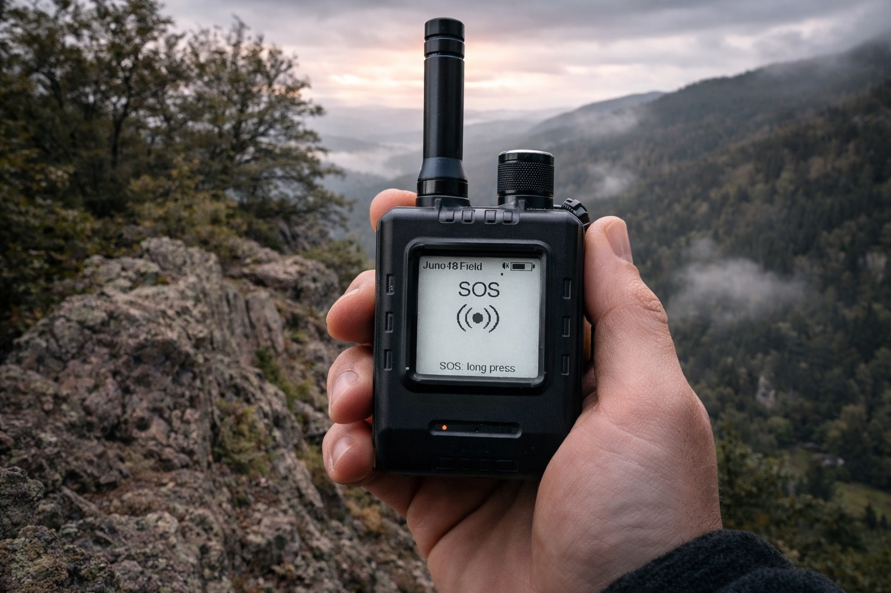
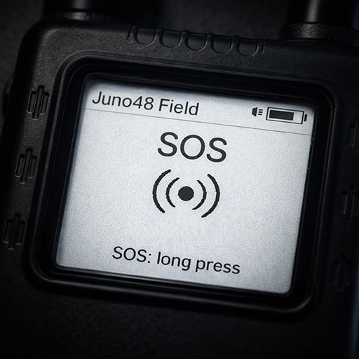
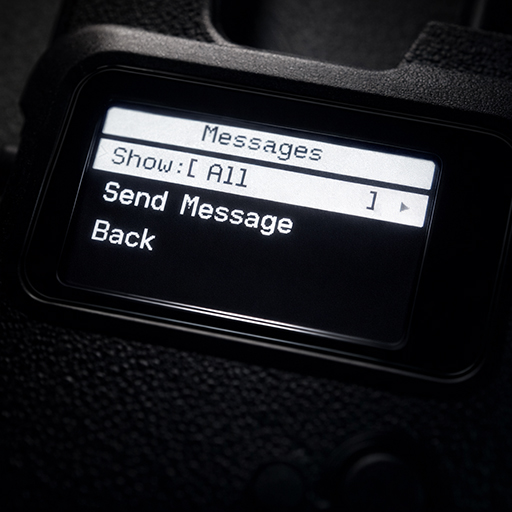
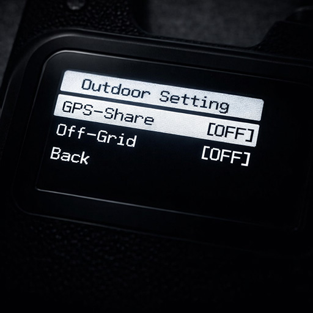
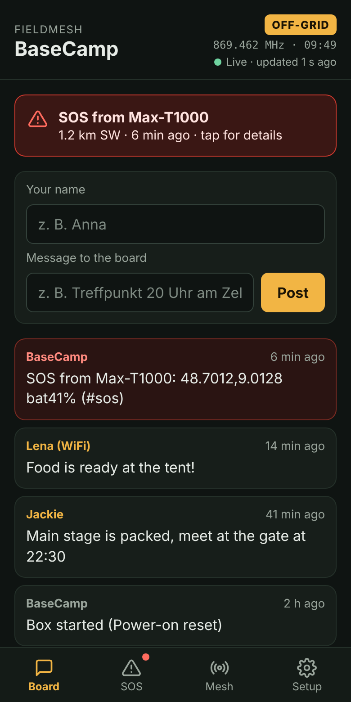
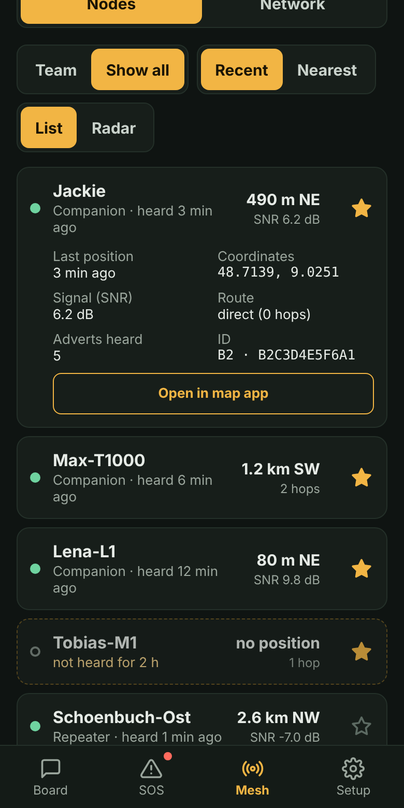
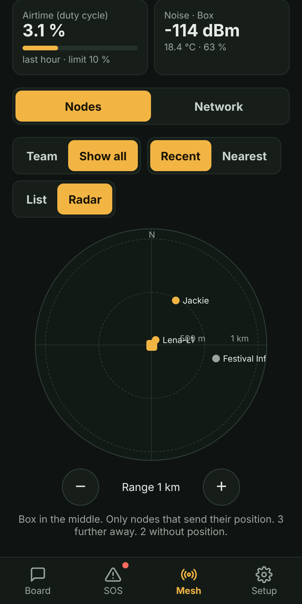
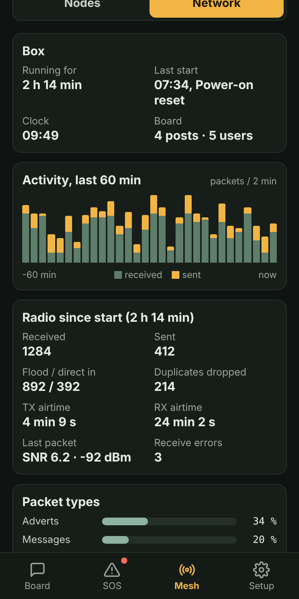

# FieldMesh

**A MeshCore firmware fork optimized for outdoor use — festivals, hiking, off-grid events, and situations where you need your radio network to do more than stock MeshCore offers.**

<p align="center"></p>

Built on [MeshCore](https://github.com/meshcore-dev/MeshCore) ·  Based on MeshCore v1.18.0 ·  Download latest [release](../../releases/latest)

> **Updating from V5.x?** Updating from V5.x to V6.x could reset the node identity (new public key) and settings on some devices. **Export your private key in the MeshCore app before updating.** From v6.1 on, FieldMesh keeps its own backup of the identity and settings (see [Identity backup](#identity-backup)).

-----

## Why FieldMesh?

MeshCore is a great platform, but some things that matter in the field require manual workarounds or aren't there at all. FieldMesh adds:

- **Battery-friendly GPS tracking** — the GPS sleeps between fixes; your node sends its position when you move, plus a heartbeat every 10 minutes, zero-hop only — no extra network load
- **A dedicated tracking page** — see your contacts' GPS positions and distances at a glance
- **A real Off-Grid mode** — builds on MeshCore's Client Repeat feature, with legal frequencies picked automatically for your region and a one-press toggle instead of manual parameter entry
- **An SOS system** — send and receive emergency alerts with buzzer alarm, even if your phone isn't connected
- **Message history** — browse received messages directly on the device, no phone required
- **Text input & send** — compose and send channel messages via joystick on supported devices (Wio Tracker L1)
- **FieldMesh Repeater** — turns a Station G2 into a base station for your camp: repeater, message board, SOS display, weather and a WiFi dashboard for phones

The goal is a node you can put in your backpack, forget about, and trust that it's doing its job.

More about my motivation is readable in my [blog post](https://www.tobiasguertler.de/blog/en/fieldmesh).

**Contents:** [Features](#features) · [UI & Usability](#ui--usability) · [FieldMesh Repeater (Station G2)](#fieldmesh-repeater-station-g2) · [Hardware](#hardware) · [Building](#building) · [Limitations](#limitations--known-issues) · [FAQ](#faq)

-----

## Features

### GPS Tracking & Auto-Advert

FieldMesh separates two things that stock MeshCore conflates: *when did I last hear from this node* and *when did this node last have a GPS fix*. The RECENT page shows all recently heard nodes. The TRACKING page shows only nodes that have sent a GPS position — with distance calculated via Haversine formula — color-coded green (< 5 min) or yellow (older). Only contacts marked as favourites in the companion app appear on the Tracking page (max. 3).

**GPS duty cycle (v6.1).** While GPS is on, the receiver takes a fix every 2 minutes and sleeps in between — the same approach Meshtastic uses. The search time adapts to the sky the receiver can see (short indoors, longer under open sky), and the satellite systems the chip supports (GPS, GLONASS, Galileo, BeiDou) are all switched on. On the T1000-E this gave about 2–2½ days with GPS on in our tests (no exact current measurement). Devices whose GPS cannot be switched off keep it running as before.

**Tracking (GPS-Share on).** Your node sends its position when it matters instead of on a fixed timer:

| When | What is sent |
|---|---|
| First fix after GPS-Share or GPS is switched on | Advert with position |
| You moved ≥ 100 m since the last sent position | Advert with position, at most every 2 min |
| Moving fast (≥ 30 km/h, e.g. by car or bike) | Fix every 60 s, adverts at most every 60 s |
| Nothing changed for 10 min | Heartbeat advert (with position if the last fix is ≤ 2 min old) |

Adverts are sent **zero-hop in normal mode**, so they only reach nodes in direct range without adding load to the wider network. In Off-Grid mode they are flooded, which is the right behaviour when you're actively trying to extend reach across a local group. A position is only included when the fix is at most 2 minutes old — never stale or cached coordinates.

**ThinkNode M1 GPS switch:** the GPS only runs when the hardware switch **and** the GPS setting are on. Turning the switch on also turns the setting on.

### Off-Grid Mode

MeshCore has a feature called **Client Repeat** where a node actively relays packets to extend network reach. FieldMesh builds on this — but the upstream frequency defaults for Client Repeat were problematic: the EU 433 MHz value was a single illegal point frequency, the 869 MHz value landed in a sub-band with 0.1% duty cycle (practically unusable), and the 915 MHz value was outside the legal band in some regions.

FieldMesh corrects the frequency ranges to legal values and adds a **one-press Off-Grid toggle**. It switches to a dedicated off-grid frequency and enables Client Repeat in one step, saving your normal parameters automatically so you can switch back without re-entering anything.

**The region is picked automatically (v6.1)** from your normal frequency — one firmware file for all regions:

| Your normal frequency | Off-Grid uses |
|---|---|
| below 900 MHz (EU/UK) | **869.4625 MHz** / BW125 / SF11 / CR5 (EU sub-band g3: 500 mW ERP, 10% duty cycle) |
| 900 MHz and above (US/AU) | **916.4625 MHz** / BW125 / SF11 / CR5 |

**Off-Grid uses a completely separate frequency from your normal MeshCore network.** For example, the EU/UK Narrow preset runs on 869.618 MHz / BW62.5. Off-Grid runs on 869.4625 MHz / BW125. The two signals don't overlap — there is a ~62 kHz gap between them. You can run Off-Grid mode at a festival or in the field without interfering with the wider MeshCore network around you.

Switching modes triggers an immediate advert so nearby nodes know you've changed frequency.

Frequency ranges are set correctly for legal operation:

|Region       |Range                              |
|-------------|-----------------------------------|
|EU 433 MHz   |433.050 – 434.790 MHz              |
|EU 869 MHz   |869.400 – 869.650 MHz (Sub-Band g3)|
|US/AU 915 MHz|915.000 – 928.000 MHz              |

> Off-Grid has no frequency for other regions (e.g. India, Japan, Korea). Do not use Off-Grid there.

#### Smarter relaying in Off-Grid (v6.2)

In Off-Grid every FieldMesh device relays. With many devices close together (festival, camp, ski area) that used to mean every packet was sent again by everyone at once — packets collided and the channel filled up. Since v6.2 FieldMesh uses the **managed flooding of Meshtastic**, a method proven in the field. Our simulations: 20 devices get about the delivery that 10 devices had before (adverts and messages ~92 % instead of ~65 %), with half the airtime.

- **Wait for a free channel:** a device waits up to 30 s for a free channel instead of sending over others after 4 s.
- **Far devices relay first:** the relay delay depends on how well the packet was heard. A device that hears the sender weakly (probably further away) relays early, devices close to the sender wait longer.
- **No duplicate adverts:** if a device hears that another one already relayed an advert, it drops its own relay. **Messages and SOS are always relayed**, exactly as before.
- **FieldMesh Repeater (Station G2) relays last:** it always relays, but if another device relayed first, it waits until the companions had their turn (Meshtastic `ROUTER_LATE`). A badly placed box (in the car, in the valley) fills gaps instead of talking over the group.
- Switching Off-Grid on or off drops all relays still waiting, so nothing heard in one network is sent into the other.
- **The repeater relays everything in Off-Grid:** region / scope rules and the hop limits for un-scoped packets and adverts (`flood.max.unscoped`, `flood.max.advert`) only apply in normal operation, and its own packets go out without scope, like those of the companions. Still applied in Off-Grid: `set repeat off`, the general `flood.max` limit and loop detection.

What you notice:

- Messages take a few seconds longer per hop (about 1–22 s at SF11 instead of 0–4 s). Direct messages get 44 s more time for the delivery confirmation, so they are not shown as failed while the reply is on its way. If the repeater is the only link between two groups, it can take ~15 s longer.
- In thin networks without a repeater (one device as the only link between two groups) a few more adverts (positions) can get lost; messages arrive more reliably than before. A FieldMesh Repeater at that spot fixes it.
- If you set an interference threshold (`int.thresh`) and there is constant noise, a device in Off-Grid sends only after 30 s instead of 4 s.
- Counters (Off-Grid only): RADIO page of the ThinkNode M1 shows `Flood TX` and `Relay skip` (adverts not relayed because another device did), the Wio Tracker L1 shows `Skip` next to the TX power. Repeater: dashboard → Network → *Relays sent late*, CLI `get offgrid`.

Normal operation (Off-Grid off) is unchanged. Devices with v6.1 or stock MeshCore in the same Off-Grid network keep working; they relay as before.

### SOS System

Long-press the button on the SOS page to open a two-step confirmation screen (accidental trigger protection). On devices without a display (T1000-E), click once, then press again and hold for 5 seconds (v6.2, see [Headless devices](#ui--usability)). FieldMesh looks for a channel whose name contains "sos" (case-insensitive) and sends your position and battery level:

```
!SOS 48.7636,9.1621 bat78%
!SOS no GPS bat78%
```

The position is used if the last fix is at most 2 minutes old. Sending an SOS switches the GPS on if it was off, and it stays on afterwards (v6.2). For 10 minutes after sending, the GPS runs without pause; if the first SOS went out without a position, it is sent once more as soon as a fix is available. ThinkNode M1: if the hardware GPS switch is off, the display shows "GPS switch is off!" — turn it on within the 10 minutes and the SOS is still resent with position. Switching Off-Grid on or off (or changing the radio settings) drops a pending resend, so it never goes out into a network that did not get the first SOS.

On the receiving end: an `!SOS` message **in an SOS channel** (name contains "sos") triggers a buzzer alarm that overrides quiet mode and loops until manually acknowledged. The alert screen shows the sending node's name. Normal messages are suppressed while an SOS alert is active. `!SOS` in any other channel (e.g. Public) is shown as a normal message — no alarm (v6.1).

### Message History & Text Input

Standalone messaging — no phone required.

**Message History (all devices)**

Received messages are stored in a RAM ring buffer (up to 32 entries) and browsable directly on the device. The home screen shows an unread counter and the name and timestamp of the most recent message from a favourite contact. Long-pressing on the home screen opens a filter menu where you can choose to view all messages or messages from favourites only.

The history view shows one message at a time — newest first — with sender name, channel name or `[DM]`, timestamp, and message text. Short press advances to the next message; long press clears all remaining messages at once. When you've stepped through all unread messages, the display returns to the home screen automatically.

The unread counter in the UI is independent from MeshCore's internal sync queue — browsing or clearing messages on the device never affects smartphone sync.

**Text Input & Send (Wio Tracker L1 only)**

On the Wio Tracker L1 (joystick input), you can compose and send messages directly from the device. From the message filter menu, select "Send Message" to start the flow:

1. **Channel selection** — choose from your configured channels using the joystick
2. **Text composition** — select characters one by one using left/right on the joystick, confirm each with a short press; long press sends the message
3. After sending, a brief "Sent!" confirmation is shown before returning to the message history

Message length is limited to 20 characters. This feature is not available on the ThinkNode M1 (single-button input only).

### Identity Backup

Since v6.1 FieldMesh keeps a copy of the node identity (`/_main.id`) and settings (`/prefs.json`) in a second file system: the external QSPI flash on ThinkNode M1, Wio Tracker L1 and MeshTracker X1, a separate area of the internal flash on the T1000-E. If the main copy is lost (for example after an update), it is restored automatically on the next start.

A factory reset from the app or CLI also clears the backup — that is how you really start over. BLE pairings are not part of the backup.

-----

## UI & Usability

- Splash screen with version info and "FieldMesh" branding
- Backlight fix for Elecrow M1
- → [UI images](docs/FieldMesh/images/)

<p align="center">
  
  
  
</p>

<details>
<summary><strong>Devices with a display (ThinkNode M1, Wio Tracker L1)</strong></summary>

**Home screen pages** (left to right): Messages · Recent · Tracking · Radio · GPS · Sensors (where available) · Repeater discovery · SOS

| | ThinkNode M1 (one button) | Wio Tracker L1 (joystick) |
|---|---|---|
| Next / previous page | Short press / double press | Joystick right / left |
| Page action | Long press | Long joystick press (short press on Messages, GPS and Repeater discovery) |
| Buzzer on/off | Triple press | Triple press on the back button |
| Back | — | Back button |

**Page actions (long press):**

| Page | Action |
|---|---|
| Messages | Open the message menu (all messages, favourites only, *Send Message* on the L1) |
| Recent | Send an advert now |
| Tracking | Open *Outdoor Settings*: **GPS-Share** (tracking) and **Off-Grid** on/off |
| GPS | GPS on/off |
| Repeater discovery | Scan for repeaters in direct range |
| SOS | Open the SOS send screen (two steps) |

In the message history a short press shows the next message, a long press clears all. On an SOS alarm, a long press acknowledges it.

Long press within the first 8 seconds after power-on starts the CLI rescue mode (upstream).

</details>

<details>
<summary><strong>Headless devices (T1000-E, RAK WiseMesh TAG)</strong></summary>

Headless devices (no display, single button) support a focused set of features:

- receive and relay mesh messages, GPS tracking
- toggle Off-Grid mode
- send SOS (click + hold) and receive SOS alarms via buzzer
- send adverts, toggle GPS + tracking, toggle buzzer mute

| Button | Action |
|---|---|
| 1× | Acknowledge an SOS alarm |
| 1× + hold 5 s | Send SOS (v6.2, see below) |
| 2× | Send an advert now |
| 3× | Buzzer on/off |
| 4× | GPS and tracking (GPS-Share) on/off together (v6.2, saved, survives a restart) |
| 5× | Off-Grid on/off |
| Long press | Power off (within the first 8 s after power-on: CLI rescue mode) |

**Sending SOS (v6.2):** press once, then press again within half a second and **hold**. The buzzer beeps faster and faster and the LED blinks along. After 5 seconds the SOS is sent (one long tone). Release earlier to cancel (short descending tone) — nothing is sent. Three short low tones mean no SOS channel was found. A normal long press without a click before still powers off.

**4×** switches GPS and tracking together: if both are on, both go off; otherwise both go on. GPS without tracking can still be set in the MeshCore app.

All actions give forced buzzer feedback — even when the buzzer is muted:

| Tone | Meaning |
|---|---|
| Ascending (c → e) | Feature turned on (GPS + tracking, buzzer, Off-Grid) |
| Descending (e → c) | Feature turned off / SOS countdown cancelled |
| Double beep | Advert sent |
| Faster and faster beeps | SOS countdown (click + hold) |
| Long tone | SOS sent |
| Three short low tones | SOS not sent — no SOS channel |
| Continuous siren | SOS alarm received — press once to acknowledge |

**Status LED (T1000-E, v6.2):**

| LED | Meaning |
|---|---|
| On for 2 s | Starting |
| Short flash every 4 s | Normal |
| Soft pulse every 4 s | Tracking on (GPS + GPS-Share) |
| Blinking faster and faster | SOS countdown |
| Fast blinking | SOS alarm received |

Off-Grid, charging and low battery are not shown on the LED.

The Off-Grid state is saved and restored on boot. To check it without a display: press 5×, listen (ascending = was off, now on; descending = was on, now off), then press 5× again to return to the original state.

</details>

-----

## FieldMesh Repeater (Station G2)

<p align="center">
  
  
  
  
</p>

The FieldMesh Repeater turns a **Station G2** into a base station for a camp, a festival or a multi-day tour — for example in a box with a power station. It is a normal MeshCore repeater (all repeater settings and CLI commands work as usual) with these additions:

- **Off-Grid** — switch the whole repeater to the Off-Grid frequency of your FieldMesh nodes and back, live, from the menu, the CLI or the dashboard
- **Message board** — a room server as a **second identity** next to the repeater (own name and key, e.g. "BaseCamp"); the repeater keeps repeating
- **Room commands** — `!weather`, `!ping`, `!status` for everyone, `!commands` and `/<CLI command>` for the repeater admin, right from the room chat
- **SOS on the board** — SOS messages heard in your SOS channels appear on the board and in the dashboard
- **WiFi dashboard** — an open WiFi for phones with board, SOS, nodes (list and radar), network statistics and setup
- **Weather** — phones in the WiFi that have mobile data load a 48 h forecast for the box; `!weather` (or `!wetter` in German) answers in the room even when nobody has internet out in the field

The transmit power is never changed by FieldMesh — keep the manufacturer's recommended setting for the Station G2.

### Getting started

1. **Flash the full image once.** The repeater uses a larger app partition, so the first installation must be the full image (`…_full.bin`) written at address **0x0** with [esptool-js](https://espressif.github.io/esptool-js/) (Chrome/Edge on a computer). Do **not** use *Erase Flash*. Put the G2 into download mode: hold the download button, press reset briefly, release.
   > Coming from a stock MeshCore repeater? Back up your key first: `get prv.key` on the USB serial console (restore with `set prv.key …`). In one of our tests settings and identity were lost when switching to the new partition table.
2. **Set the repeater up as usual** (name, admin password, radio preset, location) with the MeshCore app or the CLI. Set the box position with `set lat` / `set lon` or later in the dashboard — it is needed for distances, the radar and the weather.
3. **Turn on the board:** `set roomserver BaseCamp` (or *Room* in the G2 menu). Optional password: `set room.pass <pw>`.
4. **Turn on the WiFi dashboard:** `set wifi on` (or *WiFi* in the G2 menu). The WiFi is named after the room (or after the repeater while the room is off).
5. **Stick a QR code on the box** pointing to `http://192.168.4.1`. Phones join the WiFi, open the address and are moved on to `http://<room name>.local` where supported (e.g. "BaseCamp" → `http://basecamp.local`).
6. **Optional:** log in under *Setup* with the repeater admin password, add your SOS channel (e.g. `#sos`) and star your team members in *Mesh*.

### Menu on the G2

Short press = next page, long press = action. The display always wakes up on the status page.

| Page | Long press |
|---|---|
| Status | — (mode, frequency, SF, BW, CR) |
| Off-Grid | Off-Grid on/off (EU/US picked automatically) |
| Room | Board on/off (shows clients and posts) |
| Room reset | Deletes posts, users and password; the name stays. Long press twice within 5 s |
| WiFi | Dashboard WiFi on/off (shows the WiFi name, `192.168.4.1` and connected phones) |
| Power | Turn off |

### The board (room server)

The room is a second identity with its own key and name, so the apps show it as a normal room server next to the repeater. Without a password everyone can read and write; with a password everyone who knows it. Changing the password logs everybody out. The board keeps the last 32 posts; posts and logged-in users survive a restart.

The box posts on its own: a short note when it starts ("Box started (…)") and every SOS heard in an SOS channel. Posts from the dashboard appear as "Name (WiFi)".

**Commands in the room chat:**

| Command | Who | Answer |
|---|---|---|
| `!help` | everyone | The user commands (one message, only to you) |
| `!weather` / `!wetter` | everyone | Weather for the box location, **to everyone** on the board — in English (`!weather`) or German (`!wetter`) |
| `!ping` | everyone | Signal check: SNR, RSSI and hops (only to you) |
| `!status` | everyone | Uptime, mode, frequency, users, posts, box temperature (only to you) |
| `!commands [topic]` | repeater admin | CLI commands by topic: `room`, `radio`, `wifi`, `sos`, `team`, `weather` |
| `/<CLI command>` | repeater admin | Runs any repeater CLI command remotely, e.g. `/get radio`, `/set offgrid on` |

"Repeater admin" means: your device is logged in to the **repeater** as admin. The room itself has no admin login. Commands are not posted on the board.

### WiFi dashboard

The dashboard is an open WiFi on the box (up to 10 phones) and a web page that works without internet. It updates live without reloading — open rows, zoom levels and half-typed text stay where they are. Light, dark or automatic theme (per phone).

| Tab | What you see |
|---|---|
| **Board** | Posts with time; write to the board from the phone; SOS banner |
| **SOS** | SOS messages heard by the box with position, distance and direction from the box, battery, "Open in map app" |
| **Mesh → Nodes** | Your team first ("Show all" for everyone), sorted by last heard or distance; list or radar (250 m – 10 km); team members not heard for 30 min are dimmed. "Last heard" counts adverts and also logins, posts and keep-alives to the room or the repeater |
| **Mesh → Network** | Box status, activity of the last hour, airtime, packet types, neighbour repeaters, hash collisions, live packets |
| **Setup** | Theme; after login with the repeater admin password: Off-Grid, room (name, password, clean up), SOS channels, box position, weather, firmware update, WiFi off |

There is **no captive portal**: the WiFi tells phones that it has no internet (like a printer), so phones keep using mobile data for everything else and people who only see the WiFi name are not led to the dashboard. Phones that open the page set the box clock (the G2 has no battery-backed clock; it only ever moves forward).

**Box position:** in *Setup* paste coordinates or a map link — e.g. from Apple Maps (blue dot → share or copy the coordinates) or Google Maps. Decimal degrees with point or comma, degrees/minutes/seconds and N/S/E/W (or German O for east) are understood; short links (`maps.app.goo.gl`) are not.

**Team:** stars (favourites) are set by the admin after logging in. Team members and their last known data (name, position, last heard) survive a restart; other heard nodes are kept in RAM only.

### Weather

The box has no internet. Every phone that opens the dashboard and has mobile data loads the forecast for the box location from [Open-Meteo](https://open-meteo.com) in the background when the data on the box is older than 3 hours — nobody has to do anything (or tap *Load now* in *Setup*). The box stores the next 48 hours and builds the answer from them at the moment someone asks, so one download is enough for about two days. `!weather` answers in English (°C and km/h, or °F and mph for US users — *Setup → Weather* or `set weather.units imperial`), `!wetter` in German:

```
Weather: 16°C, mostly sunny. Rain from 17:00 (80 %). Night 8°C, tomorrow 8–16°C.
Weather: 12°C, rain. Dry from about 19:00. Gusts up to 55 km/h from 15:00. Night 7°C, tomorrow 7–12°C.
Wetter: 16°, meist sonnig. Regen ab 17 Uhr (80 %). Nacht 8°, morgen 8–16°.
```

The answer gives the weather now, the most important event of the next 12 hours (thunderstorm, rain or snow, "possible" from 30 %, otherwise how long it stays dry), gusts above 50 km/h, the night low and tomorrow's range, and the age of the data when it is older than 6 hours. The weather location is the box position, or other coordinates set in *Setup* or with `set weather.loc`.

### CLI reference

All MeshCore repeater commands work as usual. FieldMesh adds:

<details>
<summary><strong>FieldMesh repeater commands</strong></summary>

| Command | What it does |
|---|---|
| `set offgrid on` / `off` · `get offgrid` | Off-Grid on/off (frequency from the normal frequency: EU 869.4625 / US 916.4625 MHz); normal settings are restored. `get offgrid` also shows the relays sent late (v6.2) |
| `set roomserver <name>` | Board on with this name |
| `set roomserver on` / `off` · `get roomserver` | Board on (last name, else the repeater name) / off |
| `set room.pass <pw>` · `get room.pass` | Room password; `set room.pass` without a password = open. Logs everybody out |
| `room.reset` | Deletes posts, users and password; name and key stay (same as the menu) |
| `room.clear posts` / `users` / `pass` / `name` | Deletes only that part (`name`: back to the repeater name) |
| `room.delete` | Deletes everything incl. name and key and turns the room off; the next `on` starts a new room |
| `channel.add #name` | Listens to a hashtag channel |
| `channel.add <name> <32 hex key>` | Listens to a private channel |
| `channel.del <name>` · `get channels` · `get sos` | Remove a channel / list channels / last SOS heard |
| `team.add <name>` · `team.del <name>` · `get team` | Team members (stars in the dashboard) |
| `team.key <12 hex> on` / `off` · `get nodes` | Team by key prefix / nodes heard |
| `set wifi on` / `off` · `get wifi` | WiFi dashboard on/off (saved) |
| `set weather.loc <lat>,<lon>` / `box` · `get weather` | Weather location: other coordinates / box position; status of the data |
| `set weather.units metric` / `imperial` | `!weather` in °C and km/h (default) or °F and mph; `!wetter` is always metric |
| `start ota` | With the dashboard on: points to *Setup → Firmware update*; otherwise the upstream OTA |

A channel whose name contains "sos" is an SOS channel: `!SOS` messages there go to the board and the SOS tab. Up to 8 channels.

</details>

### Updating the repeater

- **From the dashboard (recommended):** *Setup* → log in → *Firmware update*, upload the `…_update.bin`. Only the app is updated — settings, room, team and identity stay. The box restarts by itself.
- **Via USB:** the full image (`…_full.bin`) at **0x0** with esptool-js, without *Erase Flash*. This always works.

> **Why the full image?** The ESP32 has two app slots. An update from the dashboard is written to the slot that is not running and the box then starts from there. Web flashers that write the update file to 0x10000 always write slot 1 — if the box currently runs from slot 2, that update is ignored. The full image also resets the start slot to slot 1.

### What survives a restart

| Kept | Lost (RAM only) |
|---|---|
| Repeater settings, Off-Grid state, room (name, password, posts, users), WiFi on/off, SOS channels, team with last known data, weather forecast, clock (as a high-water mark, saved every 5 min) | Other heard nodes, SOS list in the dashboard (the SOS posts on the board stay), statistics |

-----

## Hardware

|                  |                                |
|------------------|--------------------------------|
|**Tested on**     |Elecrow ThinkNode M1 (E-Ink), Seeed Wio Tracker L1 (OLED), Seeed T1000-E (no display), Station G2 (FieldMesh Repeater)|
|**Build from source, untested**|Heltec Mesh Node T1, SenseCAP MeshTracker X1, Wio Tracker L1 E-Ink, Wio Tracker L1 1W — no prebuilt firmware|
|**Other hardware**|RAK WiseMesh TAG and similar single-button headless devices — contributions welcome|
|**Base firmware** |MeshCore v1.18.0                |

FieldMesh has been developed and tested on the ThinkNode M1 (E-Ink, single button) and the Wio Tracker L1 (OLED, joystick). Headless devices (no display, single button) are supported since V5.1 — the Seeed T1000-E is the reference device for this class. The code is written to be portable — all hardware-specific pins are in `variant.h`, layout uses runtime display size checks, and joystick-specific UI behaviour is guarded by `#if UI_HAS_JOYSTICK`. If you test it on another platform, please open an issue with your findings.

-----

## Building

FieldMesh builds the same way as MeshCore, with [PlatformIO](https://platformio.org). No additional dependencies beyond what MeshCore already requires.

| Device | Environment |
|---|---|
| ThinkNode M1 | `ThinkNode_M1_companion_radio_ble` |
| Wio Tracker L1 | `WioTrackerL1_companion_radio_ble` |
| T1000-E | `t1000e_companion_radio_ble` |
| Station G2 (FieldMesh Repeater) | `Station_G2_fieldmesh_repeater` |

`…_companion_radio_usb` environments connect to the app over USB instead of BLE.

```
pio run -e ThinkNode_M1_companion_radio_ble
pio run -e Station_G2_fieldmesh_repeater                 # firmware.bin = update file
pio run -e Station_G2_fieldmesh_repeater -t mergebin     # firmware-merged.bin = full image (0x0)
```

-----

## Limitations & Known Issues

- Tested on ThinkNode M1, Wio Tracker L1, T1000-E and Station G2 — other hardware untested
- Off-Grid knows EU/UK and US/AU frequencies only — do not use it in other regions (e.g. India, Japan, Korea)
- SOS needs a channel whose name contains "sos" — for sending and for the alarm
- Tracking page shows a maximum of 3 contacts (favourited in the companion app)
- Message history is RAM-only — stored messages are lost on reboot (intentional)
- Text input and send is available on Wio Tracker L1 only — the ThinkNode M1 single button does not support text composition
- Message send supports channels only — no direct message (DM) sending via device UI
- Repeater: switching from a stock repeater needs one full-image flash; back up the key first (see [Getting started](#getting-started))
- Repeater: the dashboard WiFi is open (no password) — anyone in range can read the board and see node positions; setup actions need the admin password
- Repeater: weather only arrives when a phone with mobile data opens the dashboard; some Android phones keep all traffic on the box WiFi and cannot load it

-----

## FAQ

<details>
<summary><strong>Why do I not see some nodes in the TRACKING view?</strong></summary>

Only nodes that have recently sent a GPS position are shown in TRACKING.
Additionally, the node must be marked as a favorite in the MeshCore app.

If a node appears in RECENT but not in TRACKING, it most likely:
- has not sent GPS data
- is not marked as favorite

</details>


<details>
<summary><strong>Why is my own position not shown?</strong></summary>

Your position is only available if your device has a valid GPS fix.

Make sure:
- GPS is enabled (via long press on the GPS screen, 4× press on headless devices — switches tracking on too — or the hardware switch on the M1)
- your device has a GPS fix (not "GPS NO FIX")

Without a GPS fix, no position can be sent or displayed.

</details>


<details>
<summary><strong>How often is my position sent?</strong></summary>

With GPS-Share on: at the first fix, whenever you moved 100 m or more (at most every 2 minutes, every 60 s when moving fast), and otherwise every 10 minutes as a heartbeat.
In normal mode, this is done with hop limit = 0 (local only). See [GPS Tracking & Auto-Advert](#gps-tracking--auto-advert).

</details>


<details>
<summary><strong>Why does my GPS show no fix for a moment?</strong></summary>

Since v6.1 the GPS sleeps between fixes to save battery and wakes up shortly before the next one (every 2 minutes). Indoors it only searches briefly; under open sky it searches longer. Open the GPS or Tracking page to keep it awake while the display is on.

</details>


<details>
<summary><strong>Why is the distance to other nodes inaccurate?</strong></summary>

The distance is only a rough estimate.
It is calculated once when a GPS advert is received and is not continuously updated to save energy.

Additionally, GPS accuracy itself can vary depending on the environment.

</details>


<details>
<summary><strong>Why are only a few nodes shown in TRACKING?</strong></summary>

TRACKING is limited to a maximum of 3 favorite nodes.
This is intentional to keep the display clean and usable in the field.

New incoming adverts may replace older entries.

</details>


<details>
<summary><strong>What happens if a node has no GPS?</strong></summary>

Nodes can still send adverts without GPS.
This allows you to see that a node is nearby even if no position is available.
To calculate distances, your own device should have GPS enabled.

</details>


<details>
<summary><strong>Why are my GPS adverts not forwarded through the mesh?</strong></summary>

In normal mode, GPS adverts are sent with hop limit = 0.
This is intentional to reduce network load and avoid unnecessary traffic.
Only in Off-Grid mode, adverts are flooded.

</details>


<details>
<summary><strong>Why am I not seeing nodes from the wider network?</strong></summary>

Check if Off-Grid mode is enabled.
In Off-Grid mode, your device operates on a different frequency and is isolated from the normal mesh.
Disable Off-Grid mode to reconnect to the main network.

</details>


<details>
<summary><strong>What does Off-Grid mode do?</strong></summary>

Off-Grid mode enables Client Repeat functionality.
Your node behaves similar to a repeater and forwards messages.
This happens on a separate frequency to avoid interfering with the main MeshCore network.

</details>


<details>
<summary><strong>Can I change the Off-Grid frequency?</strong></summary>

The Off-Grid frequency is picked automatically from your normal frequency: below 900 MHz the EU frequency (869.4625 MHz), from 900 MHz the US frequency (916.4625 MHz). One firmware file works in both regions.
Other frequencies can only be set in the code (`OffGrid.h`).

</details>


<details>
<summary><strong>Why do I see fewer nodes in Off-Grid mode?</strong></summary>

Off-Grid mode uses a separate frequency.
You will only see nodes that are also in Off-Grid mode.

</details>


<details>
<summary><strong>When should I use Off-Grid mode?</strong></summary>

Off-Grid mode is useful when:

- you are in areas without existing mesh infrastructure (e.g. mountains)
- you are operating in a closed group
- you want to avoid interfering with the main network

Note that you will not receive messages from the main mesh while in Off-Grid mode.

</details>


<details>
<summary><strong>What happens to my settings when switching Off-Grid mode?</strong></summary>

Your normal radio settings are stored and restored automatically.
Switching between modes does not require manual reconfiguration.

</details>


<details>
<summary><strong>How does the SOS feature work?</strong></summary>

The SOS function is protected against accidental triggering: a two-step confirmation on devices with a display, a 5-second click + hold with a beeping countdown on devices without one.

When activated:
- `!SOS` is sent in your SOS channel (name contains "sos")
- your GPS position is included if the last fix is at most 2 minutes old, otherwise "no GPS"
- your battery level is added
- the GPS is switched on if it was off and stays on (v6.2)
- the GPS runs for 10 minutes and sends the position once more if the first SOS had none — unless you switch Off-Grid or change the radio settings in the meantime

</details>


<details>
<summary><strong>What happens when an SOS is received?</strong></summary>

When an `!SOS` message is received in an SOS channel:

- a dedicated screen opens (devices with a display)
- the sender's node name is displayed
- the buzzer (if available) will sound
- the LED blinks fast (T1000-E)

The alarm will continue until manually confirmed. `!SOS` in other channels (e.g. Public) does not trigger the alarm.

</details>


<details>
<summary><strong>Where are received messages stored?</strong></summary>

Messages are stored in RAM only — up to 32 entries in a ring buffer.
They are lost when the device reboots. This is intentional: the device is not a permanent message store, and smartphone sync via the MeshCore companion app is unaffected by what the device UI shows or clears.

</details>


<details>
<summary><strong>Does clearing messages on the device affect smartphone sync?</strong></summary>

No. The message history shown on the device is a display copy only.
Clearing it — either one by one or all at once — never touches MeshCore's internal sync queue.
Your companion app will still receive all messages that arrived while it was connected or reconnects.

</details>


<details>
<summary><strong>Can I send messages without the companion app?</strong></summary>

Yes, on the Wio Tracker L1. Long-press on the home screen to open the message menu, then select "Send Message". You will be prompted to choose a channel, then compose your text using the joystick. Messages can be up to 20 characters long.

This feature is not available on the ThinkNode M1 — single-button input does not support text composition.

</details>


<details>
<summary><strong>Can I send direct messages (DMs) from the device?</strong></summary>

No. The text send feature supports channel messages only.
Direct messages require the companion app.

</details>


<details>
<summary><strong>What does the unread counter on the home screen show?</strong></summary>

The counter shows how many received messages you have not yet stepped through in the message history view.
It is independent from MeshCore's internal message queue and is not affected by smartphone sync state.

</details>


<details>
<summary><strong>Repeater: why does the dashboard not open by itself when I join the WiFi?</strong></summary>

On purpose. The box has no captive portal: phones see a WiFi without internet and keep using mobile data. Open `http://192.168.4.1` (QR code on the box); the page then moves on to `http://<room name>.local` if your phone supports it.

</details>


<details>
<summary><strong>Repeater: the weather says "no data yet" — why?</strong></summary>

No phone with mobile data has opened the dashboard since the box location was set. Open the dashboard with mobile data on, or tap *Load now* in *Setup → Weather*. The box also needs a position (Setup → Box position) or a weather location.

</details>


<details>
<summary><strong>Repeater: an update from the web flasher has no effect</strong></summary>

The box probably runs from its second app slot after an update from the dashboard. Update from the dashboard again, or flash the full image at 0x0 with esptool-js. See [Updating the repeater](#updating-the-repeater).

</details>

-----

## Contributing

This is a personal project that grew out of wanting a more field-ready node. If you:

- test it on other hardware and want to share results
- find a bug
- have a feature idea that fits the outdoor/off-grid use case
- want to adapt the Off-Grid defaults for another region

…feel free to open an issue or pull request. The more platforms this works on, the better.

-----

## Relationship to MeshCore

FieldMesh is a fork of [MeshCore](https://github.com/meshcore-dev/MeshCore). It is not affiliated with or endorsed by the MeshCore project. The goal is to stay close to upstream and periodically merge new releases — FieldMesh logic lives in its own files where possible, and upstream files only carry small, marked hooks. Semantic compatibility after upstream changes still requires manual review. Every touchpoint and the sync procedure are listed in [UPSTREAM_SYNC.md](UPSTREAM_SYNC.md).

-----

*FieldMesh — MeshCore for the field.*
